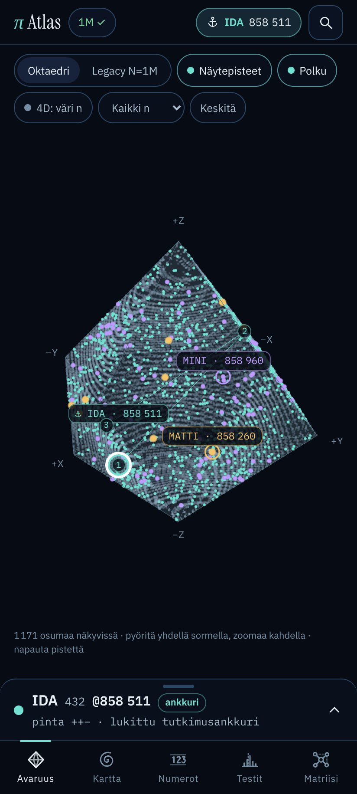
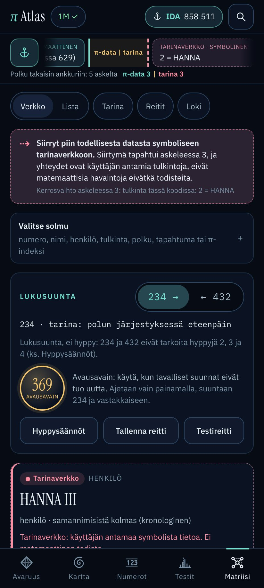

# PI ATLAS — The Geometry of a Life

Tutkimusväline, jolla piin miljoonasta ensimmäisestä desimaalista haetaan omia nimiä, numerosarjoja ja
päivämääriä. Osumat näytetään neljällä toisistaan riippumattomalla kartalla, ja niiden läheisyyttä verrataan
tilastolliseen nollamalliin.

Sovellus erottaa aina neljä asiaa:

| Luokka | Mitä se tarkoittaa |
| --- | --- |
| **Koodattu osuma** | Koodi löytyy piin *peräkkäisistä* desimaaleista. Tarkistettavissa 1D-näkymästä. |
| **Geometrinen yhteys** | Kaksi osumaa on lähellä *valitussa kartoituksessa* (spiraali, oktaedri). Kartoitus on valinta, ei piin ominaisuus. |
| **Tilastollisesti arvioitu** | Läheisyyttä on verrattu siemenelliseen nollamalliin. Vain ennalta lukittu testi voi olla vahvistava. |
| **Oma tulkinta** | Käyttäjän muistiinpanot ja tapahtumalinkit. Ne pidetään erillään matemaattisesta datasta. |



## Käyttö Android-puhelimella

1. **GitHub Pages:** avaa `https://hurjamies.github.io/piatlas/` Chromessa → ⋮ → **Lisää aloitusnäyttöön**.
   Sovellus toimii ensimmäisen latauksen jälkeen myös ilman verkkoa. Workflow
   `.github/workflows/pages.yml` testaa ja julkaisee jokaisen `main`-päivityksen. Pages otetaan käyttöön kerran:
   *Settings → Pages → Build and deployment → Source: GitHub Actions*. Yksityisestä reposta Pages toimii vain
   maksullisella GitHub-tilillä; muuten repo pitää tehdä julkiseksi.
2. **Kehityspalvelin samassa wifissä:** `npm run dev` ja avaa puhelimella terminaalin näyttämä
   `http://192.168.x.x:5173/`.
3. **claude.ai-julkaisu:** `npm run build:artifact` tuottaa yhden tiedoston version kansioon `dist-artifact/`.

Ensimmäisen version käyttötapaus toimii näin:

1. Sovellus avautuu ankkurissa **IDA 432 @858 511**. Yläpalkin ankkuripainike palauttaa siihen aina.
2. **Avaruus**-välilehdellä näkyvät nimilaput `MATTI · 858 260` ja `MINI · 858 960`.
3. Napauta osumaa. Alapaneelista näet koodin, indeksin n, pinnan, XYZ-koordinaatit, Δn:n ja 3D-etäisyyden
   ankkuriin sekä alkuperäiset numerot tarkistusmerkin kanssa.
4. Vaihda näkymää: **Kartta** (spiraali, 8 kolmiota, avattu verkko) ja **Numerot** (alkuperäinen numerojono).
5. Aja **Testit**-välilehdellä ensimmäinen kontrolloitu läheisyystesti.
6. Avaa **Matriisi** ja napauta ”Avaa ensimmäinen testireitti” (ks. seuraava luku).

## Recursive Story Matrix (Matriisi-välilehti)

Matriisi on rekursiivinen numerokartta ja haarautuva tarinamoottori. Jokainen solmu (koodi, numero, osuma,
nimi, henkilö, polku, tulkinta, tapahtuma) avautuu uusiksi solmuiksi, ja reitti lähtöankkurista näkyy
murupolkuna. Määrittely: [docs/MATRIISI.md](docs/MATRIISI.md).



**Kaksi kerrosta pidetään erillään.**

| Kerros | Sisältö | Tunnistat sen |
| --- | --- | --- |
| **π-data** | piin desimaalit, koodit, osumat, Δn, kartoitukset, reittitestin p | turkoosi, yhtenäinen reunus, ✓ = tarkistettu lähdeaineistosta |
| **Tarinaverkko** | käyttäjän henkilöt, suhteet, tulkinnat, polut ja tapahtumat | ruusu, katkoviiva |

Jokainen yhteys on yhtä neljästä tyypistä: Matemaattinen, Geometrinen, Ajallinen tai Symbolinen. Jokainen
murupolun muru ja jokainen yhteysrivi näyttää sekä tyypin että kerroksen. Kun reitti siirtyy π-datasta
tarinaverkkoon, murupolussa on erotin **π-data | tarina**, murupolun alarivi näyttää kerrosten järjestyksen
(esim. ”π-data 3 | tarina 3”) ja näkymä ilmoittaa: *”Siirryt piin todellisesta datasta symboliseen
tarinaverkkoon.”* Symbolinen yhteys ei ole matemaattinen todiste.

**Käyttö puhelimella**

1. Avaa alapalkista **Matriisi** (tai osoite `…/#matriisi`). Juuri on lähtöankkuri IDA 432 @858 511.
   Lähtötunnisteet tarkistetaan lähdeaineistosta: IDA @858 511 ✓, MATTI @858 260 ✓, MINI @858 960 ✓.
2. Napauta yhteysriviä tai verkkokuvan solmua: se avautuu ja lisätään murupolkuun. Murua napauttamalla palaat
   siihen (myös Tarina-, Reitit- tai Loki-sivulta), ja ankkuripainike vie juureen. Reitillä jo olevan solmun
   avaus palaa siihen (”↺ jo polulla”), joten silmukoita ei synny. **Valitse solmu** avaa minkä tahansa koodin,
   nimen, henkilön, tulkinnan (esim. 23 tai 43), polun, tapahtuman tai π-indeksin (@n). Valinta lisätään
   murupolun loppuun askeleena ”valittu käyttäjän toimesta”: se ei ole laskettu yhteys.
3. **234 →** ja **← 432** vaihtavat lukusuuntaa. Selitysrivi kertoo, mitä suunta tarkoittaa tämän solmun
   alueissa (π-indeksi, koodi, spiraali, oktaedri, tarina, aika). Suunta ei ole hyppy.
4. **369** on erillinen avausavain. Se ajaa kuusi menetelmää molempiin suuntiin ja näyttää myös tulokset
   ”Ei uutta” sekä odotukset. **Hyppysäännöt** (+2, +3, +4 ja −4, −3, −2) ajetaan vain painamalla.
5. **Verkko** näyttää enintään 24 kohdetta kehällä, **Lista** pelkät yhteydet ryhmittäin. i-painike kertoo,
   miten yhteys laskettiin.
6. Osumasolmun **Spiraali**, **3D**, **Atlas/verkko** ja **π-indeksi** avaavat saman osuman muissa
   näkymissä. Alapaneelin **Matriisi**-painike tuo osuman takaisin: tyhjällä polulla juuri → koodi → osuma,
   muuten nykyinen polku säilyy (polulla oleva osuma palauttaa siihen, muu osuma lisätään loppuun askeleena
   ”avattu osumasta”).
7. **Tallenna reitti** tallentaa reitin, oman tulkinnan ja hypoteesin ajoituksen; reitin π-faktat tarkistetaan
   tallennettaessa. **Reitit**-sivulla reittitesti vertaa reitin lyhintä ikkunaa nollamalliin (R, siemen,
   valinnainen SHA-256-lukitus ennen ajoa). **Tarina**-sivulla muokataan henkilöitä, suhteita, tulkintoja ja
   polkuja (JSON-vienti ja -tuonti). **Loki** näyttää avaukset ja operaatiot.

**Ensimmäinen testireitti.** ”Avaa ensimmäinen testireitti” kulkee todellisia yhteyksiä pitkin:
MAX (629) → numero 2 → tulkinta ”2 = HANNA” (koodissa 629) → nimi HANNA → HANNA III. Kerros vaihtuu
tulkinnan kohdalla. HANNA III:ssa näkyvät haarat: suuntaan 234 polku A (sukupolvien jatkuvuus) jatkuu → MAX
ja polku B (ihmissuhteiden kehityspolku) → SALLA → IDA. Suuntaan 432 polku B luetaan IDA → SALLA → HANNA.
HANNA-nimestä avautuu kolmen eri henkilön kronologia HANNA I → II → III. T9-koodi 42662 on nimen ominaisuus,
ei henkilön.

**Mikä on matematiikkaa ja mikä symbolista.** Koodit, osumat, Δn, kartoitukset ja p-arvot ovat π-dataa:
laskettuja ja toistettavia. Esimerkiksi IDA @858 511:stä suuntaan 234 lähin HANNA-osuma on @858 610
(Δn +99, tarkistettu), ja koodilla 42662 on aineistossa 7 osumaa (odotus 10). Polkujen järjestys,
symbolinumerot (HANNA = 2, SALLA = 3, IDA = 4), tulkinnat ja suhteet ovat käyttäjän antamia. Polun B
numerojono 432 on sama merkkijono kuin IDAn T9-koodi, mutta se on käyttäjän numeroiden ja koodin
yhtäläisyys, ei π-havainto.

**Tarinatiedot pysyvät laitteella.** Henkilöt, kuvaukset, tulkinnat, polut, tallennetut reitit ja loki
tallennetaan vain selaimen `localStorage`en. Sovellus ei lähetä niitä minnekään. E2e-testi tarkistaa, ettei
matriisin käyttö tee pyyntöjä sovelluksen ulkopuolelle (fontteja lukuun ottamatta), ja että tarina säilyy
uudelleenlatauksessa.

## Asennus ja komennot

Vaatii Node.js 20+.

```bash
npm install
npm run dev            # kehityspalvelin (myös lähiverkkoon: --host)
npm test               # Vitest: 277 yksikkötestiä, myös täydellä 1M-aineistolla
npm run build          # tavallinen tuotantoversio → dist/
npm run build:pages    # GitHub Pages -versio → dist/ (offline-PWA)
npm run build:artifact # yksi HTML-tiedosto + data/ → dist-artifact/
npm run typecheck
```

Päästä päähän -testi ja kuvakaappaukset (Playwright, ei projektin riippuvuus):

```bash
npm run build && npx vite preview --port 4173 &
npm i -D playwright && npx playwright install chromium   # kerran
npm run e2e            # 66 tarkistusta puhelinkoossa (412 px, matriisi myös 360 px), kuvat → docs/screenshots/
PI_ATLAS_NO_WORKER=1 npm run e2e   # sama ilman Web Workeria (varapolku)
```

Ilman globaalia asennusta: `NODE_PATH=$(npm root -g) node scripts/e2e.cjs`. Ympäristömuuttuja
`PI_ATLAS_SHOTS` vaihtaa kuvien kansion, ja `PI_ATLAS_SHOTS_360` tallentaa lisäksi 360 px:n matriisikuvat.

## Mitä on toteutettu

**MVP-1 (valmis)**

- Aineiston lataus ja validointi: vain 0–9, pituus, SHA-256 (`7806ee47…7069`), piin alku 14159…, alun ”3.” ja
  rivinvaihdot siivotaan. Aineiston loppu näkyy 1D-näkymässä ja spiraalin reunassa.
- Suuremman numerotiedoston tuonti ilman koodimuutoksia; tuotu aineisto tallentuu laitteelle (IndexedDB).
- Koodaukset: T9 (valinnainen suomalainen translitterointi Å,Ä→A, Ö→O), A1Z26 (translitterointi tai
  Å=27, Ä=28, Ö=29), UTF-8-tavut kolmella numerolla, raaka numerojono ja päivämäärä (5 muotoa).
  T9:n monitulkintaisuus ja odotettu satunnaisosumien määrä näytetään.
- Kaikki täsmäosumat, myös päällekkäiset. Haku tehdään Web Workerissa; jos worker on estetty, sama koodi
  ajetaan pääsäikeessä paloittain.
- Lukittu ankkuri IDA @858 511. Ankkurin vaihto kirjataan muutoshistoriaan ja raporttiin.
- 1D-numerolinja 1-pohjaisin indeksein, tarkistusmerkki ja ankkurin lähiosumat.
- Pyöritettävä 3D-oktaedri (Three.js), näytepisteverkko, merkkipolku, nimilaput, napautusvalinta,
  π-indeksi-ikkuna ja n:n mukainen väritys (4. koordinaatti). Vertailuksi Legacy N=1M, jossa N-riippuvuus
  on merkitty näkyvästi.

**MVP-2 (valmis)**

- Kultaisen kulman spiraali (Vogel): pan/zoom, piin numerot näkyvät lähietäisyydeltä, Fibonacci-naapurit
  n ± F_k. Naapurit ovat paikkoja eivätkä osumia; täytetty neliö tarkoittaa, että kohdassa alkaa osuma.
- 8 kolmion atlas ja geometrisesti oikein avattu oktaedriverkko (tasasivuiset kolmiot, taitokset
  katkoviivalla, leikatut särmät kirjaintunnuksin).
- Sama valinta kaikissa näkymissä (3D, spiraali, atlas, verkko, 1D, paneelit).
- Naapurit: top 20 1D:n ja 3D:n mukaan, pintasuhde, Fibonacci-täsmäero tai lähin F_k, linkkigraafi
  (solmu = täsmällinen osuma) ja suodattimet.

**MVP-3 (pääosin valmis)**

- Monte Carlo -läheisyystesti: S1 ankkurin lähin B, S2 lähin A–B-pari ja S3 keskimääräinen lähin, 1D-, 2D- ja
  3D-etäisyydellä. Siemen ja R näkyvät, ja tuloksena saadaan p, Wilsonin 95 %:n väli, histogrammi ja
  osumamäärät odotusarvoineen.
- Satunnaisjonokontrolli: siemenelliset 0–9-jonot, joista haetaan samat koodit.
- Esirekisteröinti: hypoteesi ja parametrit lukitaan SHA-256-tiivisteellä. Jos sama kysymys on jo ajettu,
  tulos on eksploratiivinen myös uudella siemenellä.
- Testiloki, BH- ja Bonferroni-korjaukset sekä monivertailuvaroitus.
- Elämäntapahtumat (P5 = x, y, z, n, aikaleima). Tapahtuma linkitetään osumaan vain käsin.
  π-indeksi ja kalenteri näkyvät kahtena synkronoituna aikajanana.
- Muistiinpanot osumille, JSON-raportti ja CSV-vienti (kopiointi tai lataus) sekä muutoshistoria.

**Tarinamatriisi (MVP, Matriisi-välilehti)** — käyttö yllä, määrittely [docs/MATRIISI.md](docs/MATRIISI.md)

- Rekursiivinen avaus lähtöankkurista: murupolku, jonka jokainen muru näyttää kerroksen (π-data / Tarinaverkko)
  ja yhteyden tyypin. Kerrosvaihto näkyy erottimena, murupolun alarivillä ja ilmoituksena ”Siirryt piin
  todellisesta datasta symboliseen tarinaverkkoon”.
- Lukusuunta 234 / 432 alueittain selitettynä, erillinen 369-avausavain ja erilliset nimetyt hyppysäännöt.
- 2D-verkkokuva (enintään 24 kohdetta) ja kaikki yhteydet ryhmittäin sivutettuna listana (”Näytä kaikki”
  piirtää pitkät listat, esim. koodin 629 1 040 osumaa, vaiheittain).
- Solmuvalitsin (koodi, nimi, henkilö, tulkinta, polku, tapahtuma, π-indeksi) ja ”Avaa matriisissa” Tarina-sivulta
  ja tapahtumapaneelista; valinta näkyy murupolussa askeleena ”valittu käyttäjän toimesta”.
- Ensimmäinen testireitti MAX (629) → 2 → HANNA → HANNA III, polkujen haarat ja samannimisten kronologia.
- Tarinaeditori (henkilöt, suhteet, tulkinnat, polut, JSON-vienti ja -tuonti). Tarinatiedot tallentuvat vain
  laitteelle.
- Reitin tallennus π-faktoineen (tarkistetaan lähdeaineistosta) ja reittitesti satunnaisvertailulla,
  SHA-256-hypoteesilukitus (tällä laitteella; kattaa vain kysymyksen ensimmäisen ajon, ja tehtävänannon reitit
  ovat aina ”löydön jälkeen”), BH-q ja monivertailuvaroitus kaikkien ajojen määrällä.
- E2e-testi käy koko polun läpi puhelinkoossa (412 px) ja tarkistaa asettelun myös 360 px:n leveydellä.

**Vielä suunnitelmaa**

- 4D 16-cell -hyperoktaedrin projektiot.
- Oktaedrin pintaa pitkin kulkeva geodeettinen etäisyys. Nyt käytössä on vain suora etäisyys (chord), ja se
  nimetään sellaiseksi.
- Kontrolli vaihtoehtoisilla irrationaalivakioilla (e, √2) ja useampi valittava kartoitus.
- Oikea 10M-piiaineisto: tuonti toimii, mutta 10M-invarianssitesti käyttää 1M + 9M siemenellistä täytettä,
  koska oikeaa aineistoa ei ole ympäristössä.
- Tuomio ei vielä muutu automaattisesti BH-korjauksen mukaan. q-arvo näytetään lokissa.

## Ensimmäisen kontrolloidun testin tulos

R = 10 000, siemen 20251016, aineisto `pi_digits_1m.txt`. Komento: `npx vite-node scripts/stats-summary.ts`.

| Testi | Havaittu | p | Tulkinta |
| --- | --- | --- | --- |
| S1 ankkurin lähin MATTI, 1D | 251 des. | 0,0042 | Matala vain siksi, että ankkuri valittiin MATTIn läheisyyden vuoksi |
| S1 ankkurin lähin MATTI, 3D | 0,394 | 0,48 | Tavallinen |
| S2 lähin IDA–MATTI-pari, 1D | 143 des. | 0,94 | Tavallinen: jossain on 251:tä lähempikin pari |
| S2 lähin IDA–MATTI-pari, 3D | 0,0232 | 0,92 | Tavallinen |
| S3 MATTIen keskietäisyys lähimpään IDAan, 3D | 0,0394 | 0,51 | Tavallinen |
| Satunnaisjonot (100 kpl), S2 3D | 0,0232 | — | 88 % satunnaisjonoista yhtä lähellä tai lähempänä |

Yhteenveto: valintakorjattu testi ei näytä poikkeamaa. Koodi `432` esiintyy 1054 kertaa (odotus 1000), joten
se ei yksilöi Idaa.

## Ensimmäinen reittitesti (Matriisi)

Reitti MAX 629 → HANNA 42662 → SALLA 72552 → IDA 432. Testisuure on lyhin ikkuna, johon jokaiselta koodilta
valitaan yksi osuma (kaikki osumat mukana, ei ankkuria). R = 10 000, siemen 20261016, aineisto
`pi_digits_1m.txt`, `PIATLAS-ROUTE-1.0.0`.

| Järjestys | Lyhin ikkuna | Nollamallin mediaani | p | Tulkinta |
| --- | --- | --- | --- | --- |
| mikä tahansa | 1 898 des. (n 856 712 … 858 610) | 8 566 des. | 0,127 | Ei poikkeamaa |
| 234 (kasvava n) | 84 706 des. | 18 778 des. | 0,97 | Ei poikkeamaa |
| 432 (pienenevä n) | 3 708 des. | 18 092 des. | 0,076 | Ei poikkeamaa |

Kolme järjestystä on kolme testiä: riippumattomilla testeillä vähintään yksi p ≤ 0,05 syntyisi sattumalta
noin 14 %:n todennäköisyydellä (1 − 0,95³). Reitti tuli tehtävänannosta, ja se muodostettiin aiemmin
ilmoitettujen sijaintien ympärille (IDA @858 511 ilmoitettiin ennen tätä tutkimusta; HANNA @858 610, Δn +99,
löytyi tässä tutkimuksessa). Siksi sen hypoteesin ajoitus on ”muodostettu löydön jälkeen”, eikä lukitus muuta
sitä: kaikki kolme tulosta ovat eksploratiivisia. Laskettu ydinkirjaston funktiolla `runRouteTest`
(`src/core/matrix/route-test.ts`) samoilla parametreilla kuin Reitit-sivulla.

## Hakemistorakenne

```
src/core/        puhdas laskenta: digits, encodings, search, mapping, net, fibonacci, stats, random, neighbors
src/core/matrix/ tarinamatriisi: avaus (expand), reitti, tarinamalli, 369, hyppysäännöt, reittitesti
src/engine/      Web Worker ja pääsäikeen varapolku (sama käsittelijä)
src/state/       sovelluksen tila, tallennus (localStorage + IndexedDB), raportti, matriisin tila ja toiminnot
src/ui/          React-näkymät: Avaruus (Three.js), Kartta (canvas), Numerot, Testit, Matriisi, paneelit
src/ui/matrix/   Matriisi-välilehden osat: murupolku, ohjaus, verkkokuva, yhteyslista, Tarina, Reitit, Loki
tests/           Vitest-testit (täysi 1M-aineisto + fixture)
scripts/         e2e.cjs, artifact-wrap.mjs, make-icons.cjs, stats-summary.ts
public/data/     pi_digits_1m.txt (tutkimusaineisto)
docs/            TEKNINEN.md, MATRIISI.md ja kuvakaappaukset
.github/         GitHub Actions: testit ja Pages-julkaisu
```

Projekti siirrettiin omaksi repokseen saliohjelma-reposta, jossa se aloitettiin.

Tekninen kuvaus 3D-sijoituksesta ja tilastoista: [docs/TEKNINEN.md](docs/TEKNINEN.md).
